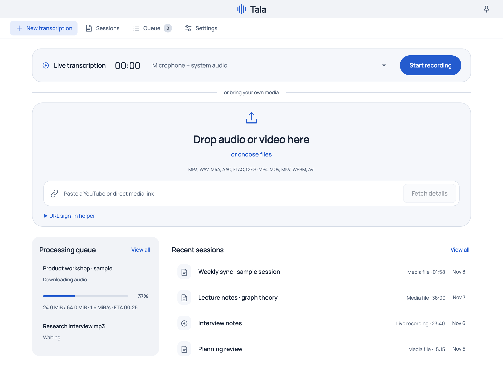
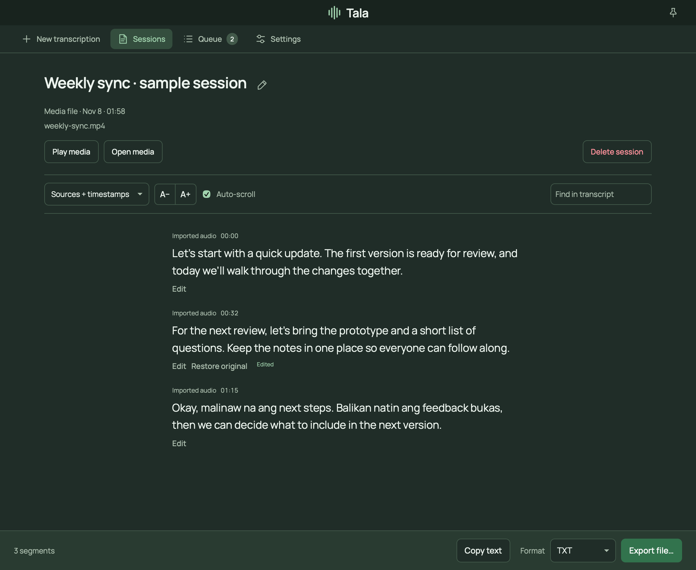
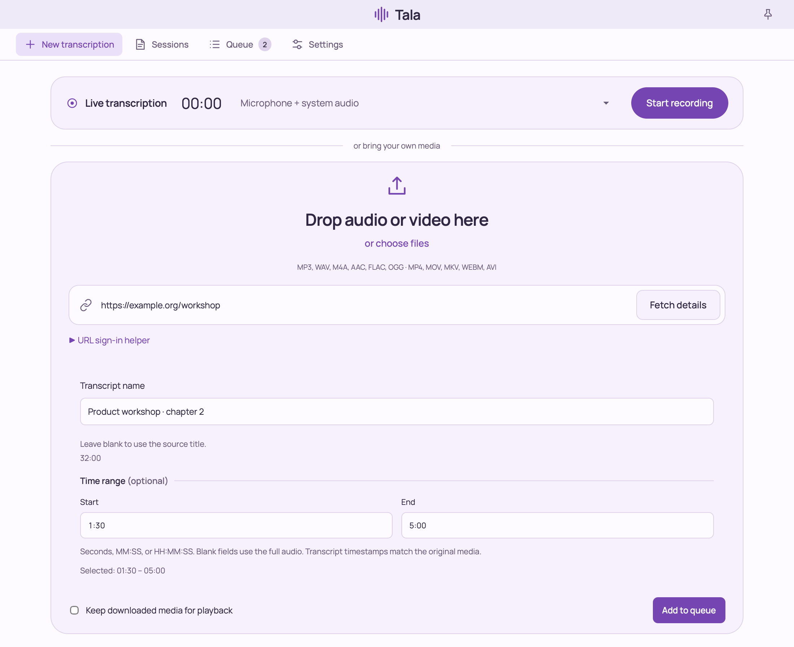

<p align="center">
  
</p>

<h1 align="center">Tala</h1>

<p align="center">
  <strong>Turn audio into text. Keep the transcription on your machine.</strong><br>
  Record, import, review, and export from a macOS dashboard or Linux CLI.
</p>

<p align="center">
  <a href="https://github.com/Ajtn05/Tala/releases/latest"></a>
  <a href="https://tala-one-kappa.vercel.app/"></a>
</p>

<p align="center">
  <a href="#get-started">Get started</a> ·
  <a href="#build-from-source">Build from source</a>
</p>



*Dashboard shown with illustrative sessions and transfer statistics.*

Tala is free, open source, and runs **Whisper locally**. No Tala account, subscription, or cloud inference is required. After the initial model download, live recording and local-file transcription work offline.

## What you can do

| | In Tala |
| --- | --- |
| **Record as you work** | Capture your microphone, system audio, or both on macOS. Record a microphone from the Linux CLI. |
| **Bring files and links** | Drop audio/video files into the dashboard, or import media URLs supported by yt-dlp. Queue multiple files for sequential processing. |
| **Choose just one section** | Set start/end timestamps down to milliseconds, and name a fetched link’s transcript before queueing it. Original media timestamps are preserved. |
| **Follow the work** | See download bytes, speed, and ETA when available, followed by separate transcription progress. Cancel and retry from the queue. |
| **Read, correct, and share** | Search transcripts, save corrections while keeping the original text, and export TXT, Markdown, SRT, or VTT. The CLI also exports JSON. |
| **Keep your language** | Automatic detection supports English, Filipino/Tagalog, Taglish, and other Whisper languages. Tala transcribes the original speech without translating or rewriting it. |
| **Make it comfortable** | Choose six color schemes, light/dark appearance, adjustable text size, and paragraph, single-line, timestamp, or source views. |

| Review and export | Name and trim an import |
| --- | --- |
|  |  |

*Open either image to see the full-size interface.*

## Get started

[Download Tala](https://github.com/Ajtn05/Tala/releases/latest) for Apple Silicon macOS or Linux x86_64. See the [1.2.0 release notes](docs/releases/v1.2.0.md) for changes and platform requirements. You can also [build from source](#build-from-source).

Tala 1.2.0 includes FFmpeg, ffprobe, and yt-dlp. Once Whisper is set up, you can import files and supported links without installing media tools separately.

### macOS

1. **Install Tala.** Open `Tala.dmg` and drag Tala to Applications on macOS 14.2 or later. If macOS blocks the ad-hoc signed app, use **System Settings → Privacy & Security → Open Anyway**.
2. **Set up Whisper.** In **Settings → Transcription models**, download a model or choose an existing supported file. Tala verifies each model before use.
3. **Make a transcript.** Open **New transcription** to record audio, drop a file, or paste a link. Grant audio capture and Documents access when macOS prompts you.

On macOS, transcripts live in `~/Documents/Tala/`. Settings and model downloads live in `~/Library/Application Support/Tala/`.

### Linux

Extract `tala-linux-x86_64.tar.gz` or [build the CLI](#build-from-source). Keep the extracted `tala-tools` folder next to the executable.

```sh
./tala --ensure-model
./tala --record --duration 20s
./tala --transcribe lecture.mp4
```

The Linux CLI uses XDG data and config directories. On either platform, use `TALA_DATA_DIR` and `TALA_OUTPUT_DIR` to choose an isolated workspace.

## Everyday workflows

### Record → review → export

Choose **Microphone only**, **System audio only**, or **Microphone + system audio**, then start recording. Stop to finish the transcript. In the viewer, search with **⌘F**, hover or focus a segment to **Edit**, and use **Copy text** or **Export file…** in the bottom toolbar. Corrections can be restored to their original text.

### Choose a transcription model

In **Settings → Transcription models**, download the models you want and set a default. **Everyday & live** uses Whisper Large v3 Turbo Q5. **Higher accuracy** uses full Whisper Large v3 for difficult recordings. **Low memory** uses Whisper Small Q5. The original **Full Turbo** is also available.

The **Model** picker beside recording and in import review applies to that transcription. Set **Before transcription** to **Ask each time** if you prefer to pick for every run. Queued jobs keep their model when you change the default or retry.

### Import only the part you need

Drop a file, or paste a link and choose **Fetch details**. For a link, edit **Transcript name** before queueing. Set **Start** and **End** using seconds (`90`), `MM:SS` (`1:30`), or `HH:MM:SS` (`1:02:30`). Milliseconds such as `1:30.250` also work. Blank fields use the beginning/end of the source.

Only the selected audio is transcribed. Subtitle timestamps retain the source timeline. URL imports download the complete source before processing the selection.

For files or links with long pauses, enable **Settings → Recognition → Skip nearly silent import windows**, or pass `--skip-quiet-imports` in the CLI. Source timestamps are preserved. Leave the option off for very faint recordings.

### Use a link that needs sign-in

Expand **URL sign-in helper**, select your browser/profile, and **Open site to sign in**. Save the selection and fetch details again. **Zen** supports profile discovery. **Dia** and unlisted browsers use a Netscape `cookies.txt` export. **Copy URL** lets you open the link in any browser.

Access depends on the website and yt-dlp support. Use the browser sign-in helper for links your browser account can access.

### Work from the terminal

Run these commands from the checkout after `make build`. Put options before input paths and quote URLs.

```sh
# Plain text, subtitles, or one selected interval.
./tala --transcribe lecture.mp4
./tala --model-id small-q5 --ensure-model
./tala --model-id small-q5 --transcribe lecture.mp4
./tala --format srt --transcribe lecture.mp4 > lecture.srt
./tala --start 1:30 --end 5:00 --transcribe lecture.mp4

# A signed-in link, or a timed microphone recording.
./tala --cookies-from-browser zen --transcribe 'https://example.org/media'
./tala --record --duration 1m

# Find saved sessions and export one without loading the model.
./tala --list
./tala --export SESSION_ID --format md > notes.md
```

Progress goes to **stderr** and transcript output goes to **stdout**. Use `--progress=auto|always|never` to control the display. Run `./tala --help` for the full list of options.

## Questions before you start

<details>
<summary><strong>Does my audio go to a cloud transcription service?</strong></summary>

Recognition runs on your machine. Initial model downloads and media URL imports use the internet. Once the model is set up, microphone recording and local-file transcription can work offline.

</details>

<details>
<summary><strong>Can I use a model I already have?</strong></summary>

Yes. Choose a supported Whisper GGML model in **Settings** or use `--model /path/to/ggml-large-v3-turbo.bin`. Tala verifies its SHA-256 checksum before using it in place.

</details>

<details>
<summary><strong>What survives an update?</strong></summary>

Tala stores models, settings, transcripts, corrections, and queued imports outside the app bundle. Tala 1.0 uses a separate workspace from the previous app. Existing sessions remain available in that app.

</details>

<details>
<summary><strong>How fast and accurate is it?</strong></summary>

Tala uses Metal acceleration on macOS and CPU inference on Linux. On M5-class Macs running macOS 26 or later, Tala can use Metal tensor acceleration. **Settings → Transcription models** shows its status once the model loads. Speed depends on hardware, recording length, and audio content. Vocabulary hints can help with names and specialist words but do not guarantee spelling.

</details>

## Build from source

Install Go 1.25 or later, CMake, pkg-config, and the native compiler toolchain.
On Debian or Ubuntu, install `libasound2-dev` for microphone capture. The build
uses pinned versions of PortAudio and whisper.cpp. If you run the standalone CLI
from `make build`, file imports use system FFmpeg and ffprobe. Link imports also
use system yt-dlp.

```sh
make setup
make test
make build
```

On macOS 14.2 or later, use `make bundle` and open `dist/Tala.app`. The
app requests microphone or system audio access when recording. Use
`make package` to create a disk image or Linux archive. Packaging downloads and
verifies the media tools and builds FFmpeg from source. On Debian or Ubuntu,
install `libssl-dev`, `zlib1g-dev`, `nasm`, and `unzip` to build the archive.

## Recording design

Capture adapters send timestamped PCM frames to the recorder. The recorder
groups and resamples frames, feeds a shared Whisper decoder, and saves finalized
segments with their source and timestamps. Stopping drains captured audio
before the session completes. Unit tests exercise draining, sample-rate
conversion, and cancellation on storage failure. To test real inference with
the upstream speech fixture, set `TALA_TEST_MODEL` before running `make test`.

Application code uses the [MIT license](LICENSE). Third-party components retain their own
licenses. See the notices and FFmpeg source included with the packages.
