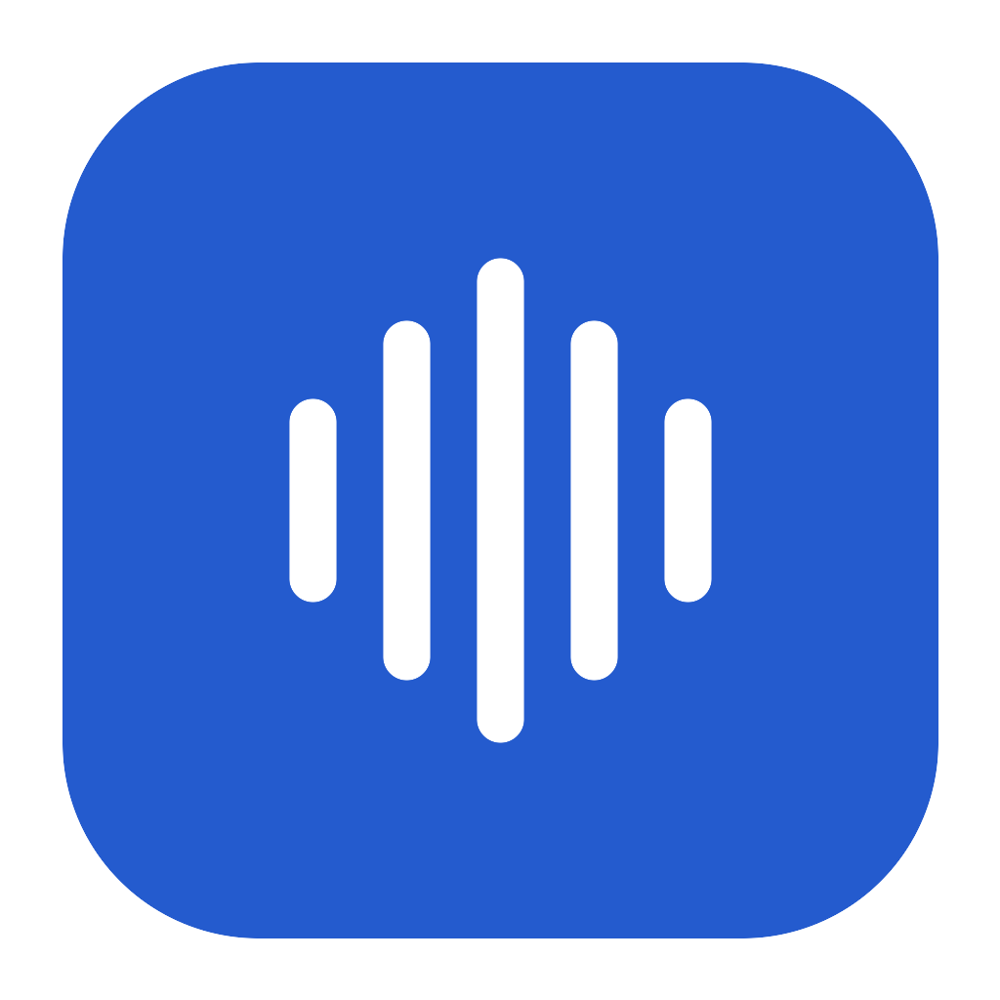
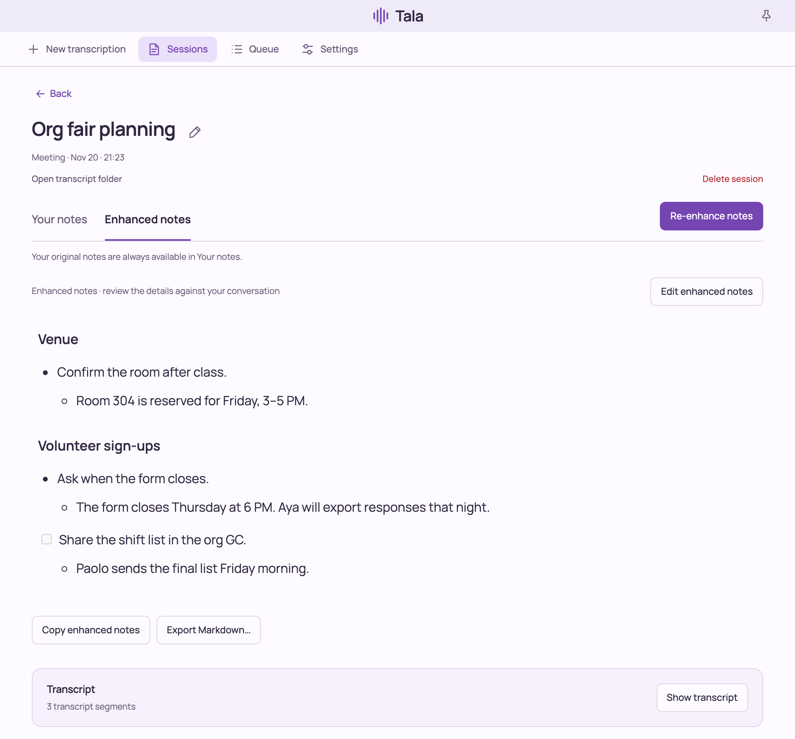
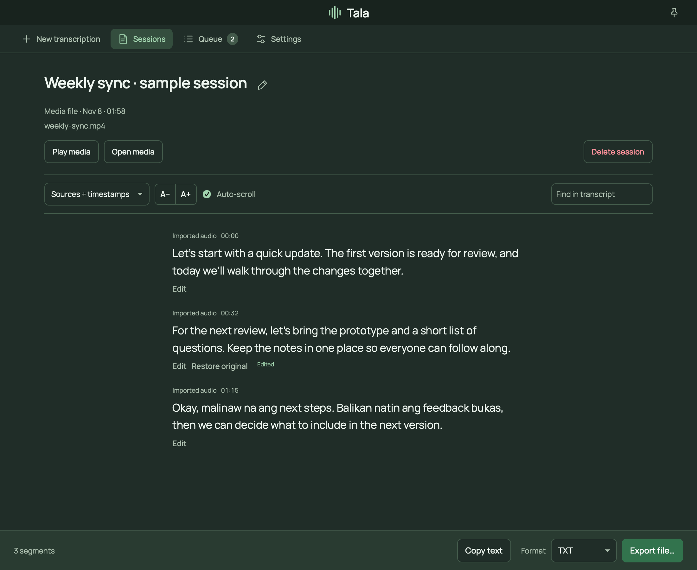
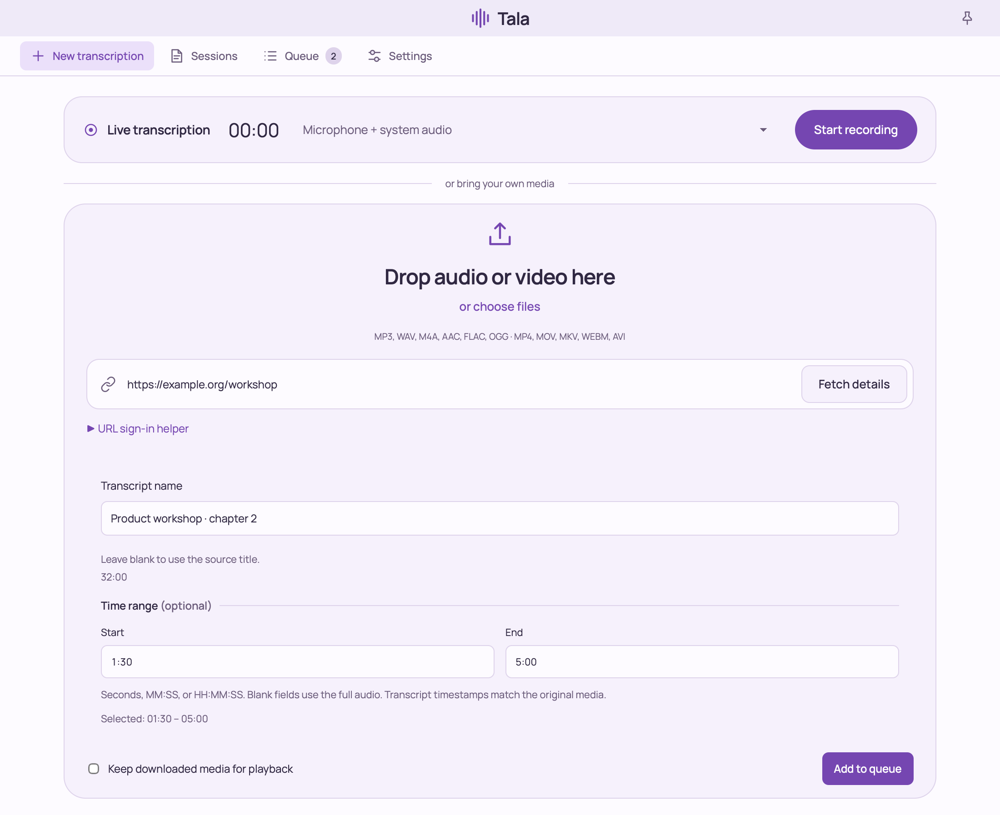

<p align="center">
  
</p>

<h1 align="center">Tala</h1>

<p align="center">
  <strong>Local transcription for lectures, meetings, and recordings.</strong><br>
  Record in English, Filipino, or Taglish and turn meeting notes into a shareable recap on Mac.
</p>

<p align="center">
  <a href="https://github.com/Ajtn05/Tala/releases/latest"></a>
  <a href="https://tala-one-kappa.vercel.app/"></a>
</p>

<p align="center">
  <a href="#new-in-tala-140">What’s new</a> ·
  <a href="#get-started">Get started</a> ·
  <a href="#build-from-source">Build from source</a>
</p>

Tala is free, open source, and runs **Whisper locally** on macOS and Linux. After the initial model download, live recording and local-file transcription work offline. The macOS app can also enhance meeting notes offline after a separate model download.

## New in Tala 1.4.0

**Start meeting** opens a Markdown notebook while Tala transcribes your microphone and system audio in the background. After the meeting, **Enhance notes** fills in details from the transcript. Your original notes and the editable enhanced version each have their own tab. You can open the transcript at any time to check a detail.

[](docs/screenshots/meeting-enhanced.png)

*The notebook shows a sample meeting.*

- **Write, preview, and share Markdown.** Keep headings and checklists, preview drafts, and copy or export either notes version. Open the same notebook on imported recordings and saved transcripts.
- **Choose how to enhance.** Run Qwen3.5 4B Q4 on your Mac, connect an eligible ChatGPT plan, or use a Google Gemini, OpenAI, or Anthropic Claude API key. Tala asks before sending notes and transcript text to a hosted provider.
- **Set your own instructions.** Customize one prompt for extending your notes and another for creating a recap from an empty notebook.

[Meeting notes guide](docs/meetings.md) · [1.4.0 release notes](docs/releases/v1.4.0.md)

## What you can do

| | In Tala |
| --- | --- |
| **Record as you work** | Capture your microphone, system audio, or both on macOS. Record a microphone from the Linux CLI. |
| **Take meeting notes** | Write in a focused notebook while microphone and system audio transcribe in the background. Enhance your notes with details from the transcript, then edit, copy, or export them. |
| **Bring files and links** | Drop audio/video files into the dashboard, or import media URLs supported by yt-dlp. Queue multiple files for sequential processing. |
| **Choose just one section** | Set start/end timestamps down to milliseconds, and name a fetched link’s transcript before queueing it. Original media timestamps are preserved. |
| **Follow the work** | See download bytes, speed, and ETA when available, followed by separate transcription progress. Cancel and retry from the queue. |
| **Read, correct, and share** | Search transcripts, save corrections while keeping the original text, and export TXT, Markdown, SRT, or VTT. The CLI also exports JSON. |
| **Keep your language** | Taglish mode transcribes English, Tagalog, and mixed Taglish by default. It skips chunks detected as other languages. Automatic mode includes all supported languages. |
| **Make it comfortable** | Choose six color schemes, light/dark appearance, adjustable text size, and paragraph, single-line, timestamp, or source views. |

| Review and export | Name and trim an import |
| --- | --- |
|  |  |

*Open either image to see the full-size interface.*

## Get started

[Download Tala](https://github.com/Ajtn05/Tala/releases/latest) for Apple Silicon macOS or Linux x86_64. The meeting notebook and note enhancement are part of the macOS app. You can also [build from source](#build-from-source).

Tala includes FFmpeg, ffprobe, and yt-dlp. Once Whisper is set up, you can import files and supported links without installing media tools separately.

### macOS

1. **Install Tala.** Open `Tala.dmg` and drag Tala to Applications on macOS 14.2 or later. If macOS blocks the ad-hoc signed app, use **System Settings → Privacy & Security → Open Anyway**.
2. **Set up Whisper.** In **Settings → Transcription models**, download **Everyday & live** (Whisper Large v3 Turbo Q5, about 547 MiB), or choose an existing supported file. Tala verifies each model before use.
3. **Make a transcript.** Open **New transcription** to record audio, drop a file, or paste a link. Grant audio capture and Documents access when macOS prompts you.

On macOS, transcripts live in `~/Documents/Tala/`. Settings and model downloads live in `~/Library/Application Support/Tala/`.

### Linux

Extract `tala-linux-x86_64.tar.gz` or [build the CLI](#build-from-source). Keep the extracted `tala-tools` folder next to the executable.

```sh
./tala --ensure-model
./tala --record --duration 20s
./tala --transcribe lecture.mp4
```

The Linux CLI uses XDG data and config directories. On either platform, use `TALA_DATA_DIR` and `TALA_OUTPUT_DIR` to choose an isolated workspace.

## Everyday workflows

### Record → review → export

Choose **Microphone only**, **System audio only**, or **Microphone + system audio**, then start recording. Stop to finish the transcript. In the viewer, search with **⌘F**, hover or focus a segment to **Edit**, and use **Copy transcript** or **Export transcript…** beneath the transcript. Corrections can be restored to their original text.

### Capture a meeting and write notes

On macOS, choose **Start meeting** from **New transcription**. Tala opens a focused notebook and captures your microphone and system audio in the background. Write in **Your notes** and choose **Save notes**. The transcript is collapsed; open it when you need to check a detail. Unsaved drafts remain available when you switch sessions or reopen Tala.

Stop recording, then choose **Enhance notes**. Tala preserves your original notes and adds transcript-backed details around what you wrote. **Enhanced notes** opens in the same main notebook, where you can review and edit the result. Switch back to **Your notes** at any time. With no written notes, Tala can create concise meeting notes from the transcript.

By default, enhancement runs on your Mac with **Qwen3.5 4B Q4** after a one-time download shared with contextual transcript review. In **Settings → Meeting notes**, you can use an eligible ChatGPT plan or supply your own Google Gemini, OpenAI, or Anthropic Claude API key. Tala asks before sending the meeting’s notes and transcript text. Editing your original notes or correcting transcript text marks an older enhancement as out of date.

Use **Preview Markdown** to check headings, lists, and task boxes. Copy or export the note version you are viewing. Transcript exports stay inside the transcript drawer. See the [meeting notes guide](docs/meetings.md) for provider setup, custom prompts, and the local workflow.

### Review wording while recording

In the macOS dashboard, go to **Settings → Live transcript review**, turn on **Suggest corrections while recording**, and save. **Reuse recording model** is the starting choice. It rechecks uncertain words against the audio when Whisper is idle. You can also choose a separate model and download it if needed.

**Qwen3.5 4B Q4** uses recent transcript lines to suggest corrections to the current line, including phrasing, spelling, and punctuation in mixed-language speech. It uses text as evidence. The Whisper review choices instead recheck uncertain words against the audio.

The draft appears first. **Accept** saves an editable correction, and **Dismiss** removes the suggestion. Live review is off by default and uses additional processing while recording.

### Choose a transcription model

New installations start with **Whisper Large v3 Turbo Q5** selected and live review off. Turbo’s smaller decoder favors speed, and Q5 compression lowers storage and memory use. Releases download models on demand. Updates keep saved model choices. [OpenAI’s Turbo release](https://github.com/openai/whisper/discussions/2363) · [whisper.cpp on quantization](https://github.com/ggml-org/whisper.cpp#quantization)

| Model | Download | Use it when | Tradeoff |
| --- | ---: | --- | --- |
| **Whisper Large v3 Turbo Q5** (`large-v3-turbo-q5`) | 547 MiB | Recording live or importing everyday audio | Lower precision can cost accuracy on difficult speech. |
| **Whisper Large v3 Turbo** (`large-v3-turbo`) | 1.51 GiB | Trying Turbo’s original weights on audio the Q5 version struggles with | Larger download and higher memory use. Any accuracy gain depends on the audio. |
| **Whisper Large v3** (`large-v3`) | 2.88 GiB | Importing difficult speech, noisy audio, or challenging Taglish | Highest memory use of the Whisper choices and potentially slower processing. |
| **Whisper Small Q5** (`small-q5`) | 181 MiB | Using a machine with limited memory, CPU, or storage | Expect more manual corrections on noisy or mixed-language speech. |
| **Qwen3.5 4B Q4** | 2.59 GiB | Enhancing meeting notes or suggesting contextual edits on macOS | Works from transcript text and can misread context. Running it during a recording adds memory and processing. |

| Setup | What to expect |
| --- | --- |
| **Everyday recording and imports.** Turbo Q5 with live review off. | One model download and no live review processing. |
| **Live word checks.** Reuse your recording’s Whisper model. | Checks uncertain words from the audio without another download. Checks can be skipped when Whisper is busy. |
| **A separate live review model.** Try Turbo Q5 for capture and Large v3 for audio review. | A second Whisper model can recheck difficult speech and uses extra memory while recording. |
| **Enhanced meeting notes.** Record with Turbo Q5 and run Qwen after stopping. | Tala frees Whisper memory before loading Qwen. The same download can suggest edits during capture if you enable text review. You can also offload enhancement with your own provider API key. |

In **Settings → Transcription models**, download the models you want or open **Use an existing model file** to reuse a supported Whisper GGML file. On Linux, `tala --help` lists the available models and `tala --model-id MODEL_ID --ensure-model` installs the one you choose. Download sizes are model file sizes. Actual memory use also includes inference buffers and depends on the setup.

The **Model** picker beside recording and in import review applies to that transcription. Set **Before transcription** to **Ask each time** if you prefer to pick for every run. Queued jobs keep their model when you change the default or retry.

### Import only the part you need

Drop a file, or paste a link and choose **Fetch details**. For a link, edit **Transcript name** before queueing. Set **Start** and **End** using seconds (`90`), `MM:SS` (`1:30`), or `HH:MM:SS` (`1:02:30`). Milliseconds such as `1:30.250` also work. Blank fields use the beginning/end of the source.

Only the selected audio is transcribed. Subtitle timestamps retain the source timeline. URL imports download the complete source before processing the selection.

For files or links with long pauses, enable **Settings → Recognition → Skip nearly silent import windows**, or pass `--skip-quiet-imports` in the CLI. Source timestamps are preserved. Leave the option off for very faint recordings.

### Use a link that needs sign-in

Expand **URL sign-in helper**, select your browser/profile, and **Open site to sign in**. Save the selection and fetch details again. **Zen** supports profile discovery. **Dia** and unlisted browsers use a Netscape `cookies.txt` export. **Copy URL** lets you open the link in any browser.

Access depends on the website and yt-dlp support. Use the browser sign-in helper for links your browser account can access.

### Work from the terminal

Run these commands from the checkout after `make build`. Put options before input paths and quote URLs.

```sh
# Plain text, subtitles, or one selected interval.
./tala --transcribe lecture.mp4
./tala --language auto --transcribe multilingual-lecture.mp4
./tala --model-id small-q5 --ensure-model
./tala --model-id small-q5 --transcribe lecture.mp4
./tala --format srt --transcribe lecture.mp4 > lecture.srt
./tala --start 1:30 --end 5:00 --transcribe lecture.mp4

# A signed-in link, or a timed microphone recording.
./tala --cookies-from-browser zen --transcribe 'https://example.org/media'
./tala --record --duration 1m

# Find saved sessions and export one without loading the model.
./tala --list
./tala --export SESSION_ID --format md > notes.md
```

Progress goes to **stderr** and transcript output goes to **stdout**. Use `--progress=auto|always|never` to control the display. Run `./tala --help` for the full list of options.

## Questions before you start

<details>
<summary><strong>Does my audio go to a cloud transcription service?</strong></summary>

Recognition runs on your machine. Initial model downloads and media URL imports use the internet. Once Whisper is set up, microphone recording and local-file transcription can work offline. If you choose a hosted meeting notes provider, Tala asks before sending notes and transcript text for enhancement.

</details>

<details>
<summary><strong>Can I use a model I already have?</strong></summary>

Yes. Choose a supported Whisper GGML model in **Settings** or use `--model /path/to/ggml-large-v3-turbo.bin`. Tala verifies its SHA-256 checksum before using it in place.

</details>

<details>
<summary><strong>What survives an update?</strong></summary>

Tala stores models, settings, transcripts, corrections, and queued imports outside the app bundle. Tala 1.0 uses a separate workspace from the previous app. Existing sessions remain available in that app.

</details>

<details>
<summary><strong>How fast and accurate is it?</strong></summary>

Tala uses Metal acceleration on macOS and CPU inference on Linux. On M5-class Macs running macOS 26 or later, Tala can use Metal tensor acceleration. **Settings → Transcription models** shows its status once the model loads. Speed depends on hardware, recording length, and audio content. Vocabulary hints can help with names and specialist words but do not guarantee spelling.

</details>

## Build from source

Install Go 1.25 or later, CMake, pkg-config, and the native compiler toolchain.
On Debian or Ubuntu, install `libasound2-dev` for microphone capture. The build
uses pinned versions of PortAudio and whisper.cpp. If you run the standalone CLI
from `make build`, file imports use system FFmpeg and ffprobe. Link imports also
use system yt-dlp.

```sh
make setup
make test
make build
```

On macOS 14.2 or later, use `make bundle` and open `dist/Tala.app`. The
app requests microphone or system audio access when recording. Use
`make package` to create a disk image or Linux archive. Packaging downloads and
verifies the media tools and builds FFmpeg from source. On Debian or Ubuntu,
install `libssl-dev`, `zlib1g-dev`, `nasm`, and `unzip` to build the archive.

## Recording design

Capture adapters send timestamped PCM frames to the recorder. The recorder
groups and resamples frames, feeds a shared Whisper decoder, and saves finalized
segments with their source and timestamps. Stopping drains captured audio
before the session completes. Unit tests exercise draining, sample-rate
conversion, and cancellation on storage failure. To test real inference with
the upstream speech fixture, set `TALA_TEST_MODEL` before running `make test`.

Application code uses the [MIT license](LICENSE). Third-party components retain their own
licenses. See the notices and FFmpeg source included with the packages.
