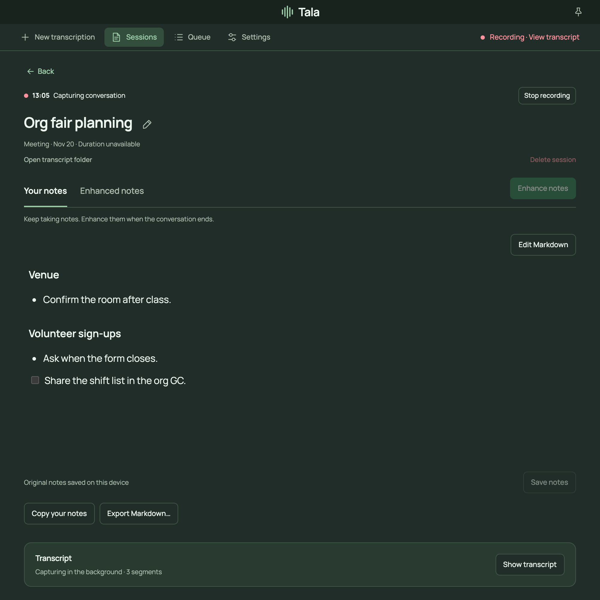

# Meetings in Tala

The meeting workflow centers the user's written notes. Write in the notebook and open the transcript when you need it. Qwen3.5 4B Q4 enhances notes on your Mac by default. You can also use your ChatGPT plan or connect a provider with your own API key.



## Use the workspace

1. On macOS, select a transcription model and choose **Start meeting**. This captures microphone and system audio together.
2. Write in **Your notes** while transcription runs in the background. **Save notes** commits them to the session. Unsaved drafts remain local across navigation and restarts.
3. Stop recording and choose **Enhance notes**. Download Qwen from the workspace if needed, or select a hosted provider in **Settings → Meeting notes**. The result opens under **Enhanced notes**.
4. Review and edit the enhanced version, or switch back to the untouched original. Copy/export uses the version being viewed. Open the transcript drawer for verification, corrections, or transcript exports.

The notebook also works on existing sessions, including file and URL imports. Enhancement preserves original note lines, headings, and their order, adding relevant details under those notes. With no written notes, Tala creates an overview and organizes the transcript's substantive points, decisions, actions, and open questions. The default prompt asks the model for plain text in each field, and Tala adds the headings and bullets. Failed or canceled enhancement preserves the last saved version. Changes to original notes or corrected transcript text mark an older enhancement as out of date.

Write Markdown in either notebook and choose **Preview Markdown** to see headings, emphasis, lists, checkboxes, tables, links, quotes, and code. The preview can show unsaved edits. **Copy notes** and **Export Markdown…** preserve the Markdown source. Change task checkboxes in the editor with `- [ ]` and `- [x]`. Preview links open in your default browser, and image references show their alt text.

Use **Back** at the top of a transcript to return to the view you opened it from. Transcripts restored at launch return to **History**.

## Customize the prompts

Open **Settings → Meeting notes → Prompts** to edit the instructions for an empty notebook or a notebook with written notes. Select **Save prompts** to apply your changes to future enhancements with any provider. Use **Reset to default** and save to restore Tala’s instructions for that mode. Tala still uses its structured output format.

Long results can span multiple model requests. If two partial summaries are too large to combine in one request, Tala keeps both in the final notes. Each request uses the selected model’s context and output token budgets.

## Connect a provider

### Use your ChatGPT plan

1. In **Settings → Meeting notes**, choose **ChatGPT plan** and click **Continue with ChatGPT**. In your browser, sign in, choose your workspace, and allow ChatGPT plan usage.
2. Return to Tala, choose a model from your account’s list, and click **Save provider**. Each enhancement asks you to confirm sending your notes and transcript text to OpenAI. ChatGPT plan limits and eligible credits apply. [ChatGPT plan usage](https://help.openai.com/en/articles/20001542-using-your-chatgpt-plan-in-other-apps-and-sites)
3. Use **Manage usage** to see your limits or **Sign out** to disconnect the renewable session. To connect another account or workspace, choose **Connect an account…** in the account picker and continue with ChatGPT.

Tala stores the account label and OAuth connection in macOS Keychain. It uses the connection for meeting note enhancement and model discovery. You can revoke Tala’s access from your ChatGPT settings. [OpenAI privacy policy](https://openai.com/policies/privacy-policy/)

### Use an API key

In **Settings → Meeting notes**, select a provider, paste your API key, and choose **Save provider**. Leave **Model ID** blank to use the model listed below. You can also enter a text model ID that supports structured outputs and is available to your API account. Tala stores keys in macOS Keychain. Select a provider to replace or remove its saved key.

| Provider | Default model | API key and usage |
| --- | --- | --- |
| Google Gemini | `gemini-3.8-flash` | Some models include a free quota. Google may use text sent on its unpaid tier to improve its products. [Create a key](https://aistudio.google.com/api-keys) · [Pricing](https://aistudio.google.com/docs/pricing#gemini-3.8-flash) · [Data terms](https://aistudio.google.com/docs/terms#data-use-unpaid) |
| OpenAI | `gpt-5.4-mini` | Usage draws on your API project’s billing or eligible credits. [Create a key](https://platform.openai.com/api-keys) · [Pricing](https://developers.openai.com/api/docs/pricing) |
| Anthropic Claude | `claude-haiku-5-5` | Usage draws on your Claude API account. [Create a key](https://platform.claude.com/settings/keys) · [Pricing](https://platform.claude.com/docs/en/about-claude/pricing) |

Claude enhancement uses a Claude Console API key. Anthropic’s linked billing beta is for Claude Console organizations and requires separate app registration and a backend. [Claude Platform OAuth](https://platform.claude.com/docs/en/manage-claude/oauth-apps/overview)

Each hosted enhancement asks you to confirm sending that meeting’s notes and transcript text to the selected provider. Audio capture and Whisper transcription run on your Mac. A long meeting can require multiple API requests. Provider quota, data terms, and charges apply. Choose **Local · Qwen3.5 4B Q4** for offline enhancement.

## Implementation

- **Capture:** the existing audio adapters, recorder, resampling, and Whisper pipeline handle meeting audio. The meeting entry point selects both sources and creates a meeting session.
- **Storage:** the optional `meeting` object lives in atomic session JSON. `notes` holds the original notebook; the existing `summary` field holds editable enhanced notes. Independent local drafts protect both versions. Transcript segments remain in the append-only journal.
- **Enhancement:** the local model uses a private Unix socket, and hosted providers use their own HTTPS APIs. Both use the same output validation. The model proposes additions keyed to original note lines and grounded in transcript quotes. Original lines are retained in order. Bounded note blocks are paired with transcript chunks. Without original notes, the concise meeting-note pipeline is used.
- **Lifecycle:** one enhancement runs at a time. It is cancellable, blocks conflicting inference/model changes, and is joined during shutdown. Original notes remain editable during enhancement; enhanced-note edits wait until it finishes or is canceled. Previous enhanced notes survive errors.
- **Freshness:** a fingerprint ties enhanced notes to the source notebook and corrected transcript. Source edits leave the result readable with an out-of-date indication. Monotonic revisions prevent delayed bridge replies from replacing newer data.
- **Export:** `meeting` exports enhanced notes when present, falling back to original notes. `meeting-original` exports only original notes. Both support TXT/Markdown. The UI exports its selected note version. Transcript and subtitle formats retain their behavior.

AI additions can contain mistakes. Review them against the transcript before sharing. Source labels such as Microphone and System Audio describe capture sources, not identified speakers.

## Verify local inference

`make test` covers storage, generation lifecycle, chunking, and structured responses. `make test-ui` covers the dashboard behavior. To exercise the real local model after building the bundled runtime, supply both paths:

```sh
TALA_TEST_SUMMARY_MODEL='/absolute/path/to/qwen3.5-4b-Q4_K_M.gguf' \
TALA_TEST_SUMMARY_RUNTIME="$PWD/third_party/build-llama/bin/llama-server" \
make test-summary
```

The integration test uses a short sample meeting and a Taglish notebook. It checks that the original outline and wording remain in order, while missing dates, commitments, and budget uncertainty come from the transcript. It skips when the two environment variables are absent.

## Meetily source review

Reviewed the linked repository's `main` branch on November 15, 2026. These links track upstream and can change.

| Source | Relevant design |
| --- | --- |
| [Architecture](https://github.com/Zackriya-Solutions/meetily/blob/main/docs/architecture.md) | Native commands and events connect the desktop UI to audio, transcription, local storage, and summaries. Its old Python backend is an unsupported archive. |
| [Audio pipeline](https://github.com/Zackriya-Solutions/meetily/blob/main/frontend/src-tauri/src/audio/pipeline.rs) | Captures and mixes microphone/system audio; recording and speech transcription have separate consumers. Tala retains its own capture pipeline. |
| [Summary processor](https://github.com/Zackriya-Solutions/meetily/blob/main/frontend/src-tauri/src/summary/processor.rs) | Chunks long local inputs, combines chunk summaries, and prompts for grounded meeting notes. |
| [Summary repository](https://github.com/Zackriya-Solutions/meetily/blob/main/frontend/src-tauri/src/database/repositories/summary.rs) | Preserves the old summary during regeneration and guards against stale completion. |
| [Summary panel](https://github.com/Zackriya-Solutions/meetily/blob/main/frontend/src/components/MeetingDetails/SummaryPanel.tsx) | Separates generation, cancellation, editing, saving, and copying in the meeting interface. |
| [Feature overview](https://github.com/Zackriya-Solutions/meetily/blob/main/README.md) | Community includes local transcription and summaries. Several broader workflows, including speaker identification and automatic meeting detection, are described as Pro features. |

This is an implementation in Tala's existing Go and native dashboard architecture. It does not embed Meetily or depend on its application. Calendar integration, automatic meeting detection, speaker diarization, and chat across meetings are outside this implementation.
