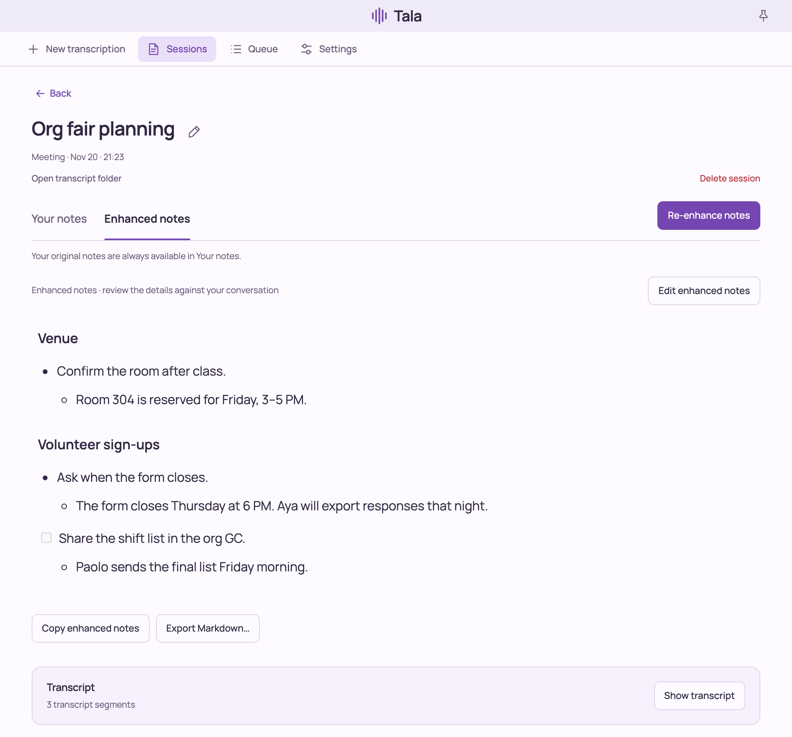

Tala 1.4.0 adds a meeting notebook to the macOS app. Take notes during a call, check the transcript when you need it, and turn your notes into a recap you can edit and share.

## What’s new

- **Take notes while Tala transcribes.** Choose **Start meeting** to capture your microphone and system audio. Your notebook stays in view and the transcript runs in the background. Drafts are kept when you switch sessions or reopen Tala.
- **Fill in what you missed.** **Enhance notes** adds details from the transcript to your outline and saves a separate, editable copy. Start with an empty notebook to generate a recap of the discussion, decisions, action items, and open questions. Editing the original notes or correcting the transcript marks older enhanced notes as out of date.
- **Preview and export Markdown.** Use headings, tables, and task lists. Copy or export either version of your notes, including from an imported recording or an existing transcript.
- **Choose a model and tailor the prompts.** Qwen3.5 4B Q4 runs on your Mac after a one-time 2.59 GiB download. You can also connect an eligible ChatGPT plan or use a Google Gemini, OpenAI, or Anthropic Claude API key. Tala asks before sending notes and transcript text to a hosted provider. Customize the instructions for enhancing written notes or starting from a blank notebook.

[Read the meeting notes guide](https://github.com/Ajtn05/Tala/blob/v1.4.0/docs/meetings.md)

## Downloads

- **Tala.dmg** for Apple Silicon Macs running macOS 14.2 or later. Drag Tala to Applications. The ad-hoc signed app may require approval in **System Settings → Privacy & Security**.
- **tala-linux-x86_64.tar.gz** for Linux x86_64, built on Ubuntu 24.04. Extract the archive, keep `tala-tools` next to `tala`, and run `./tala --ensure-model` to set up local transcription.
- **SHA256SUMS.txt** contains checksums for both packages.
